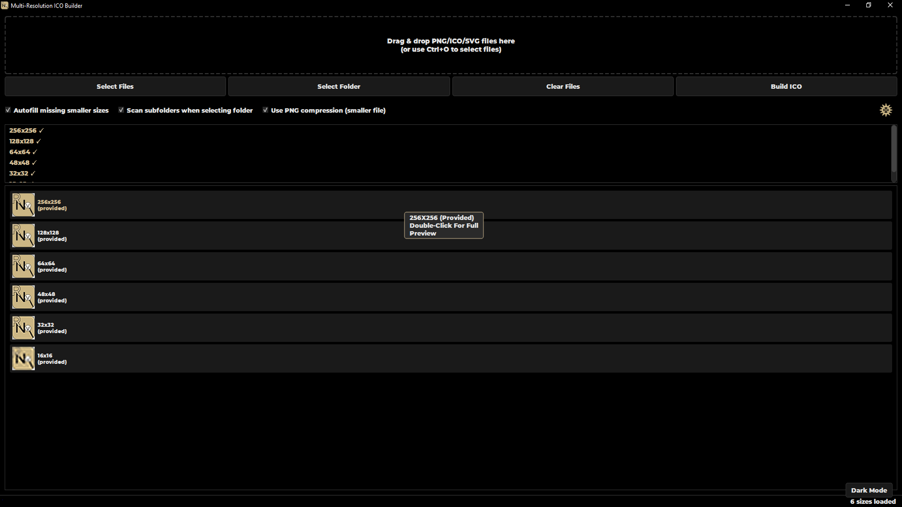
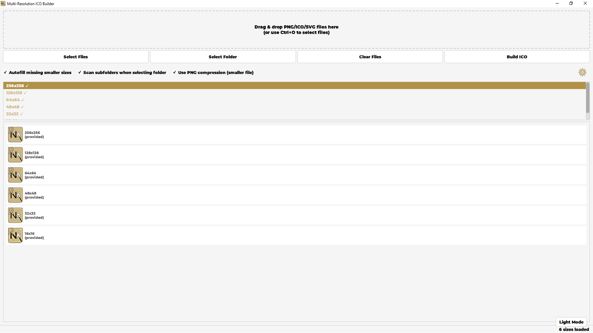
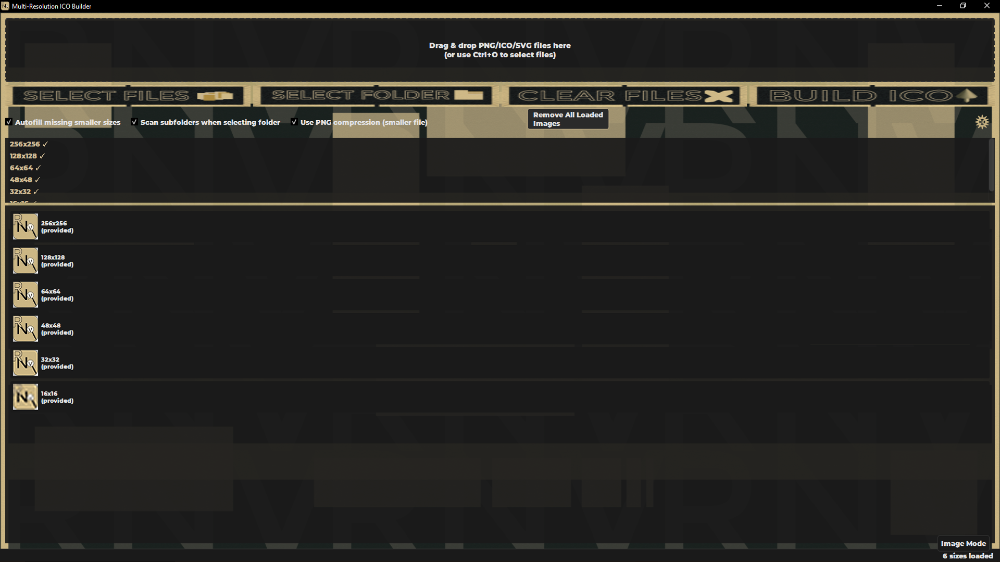
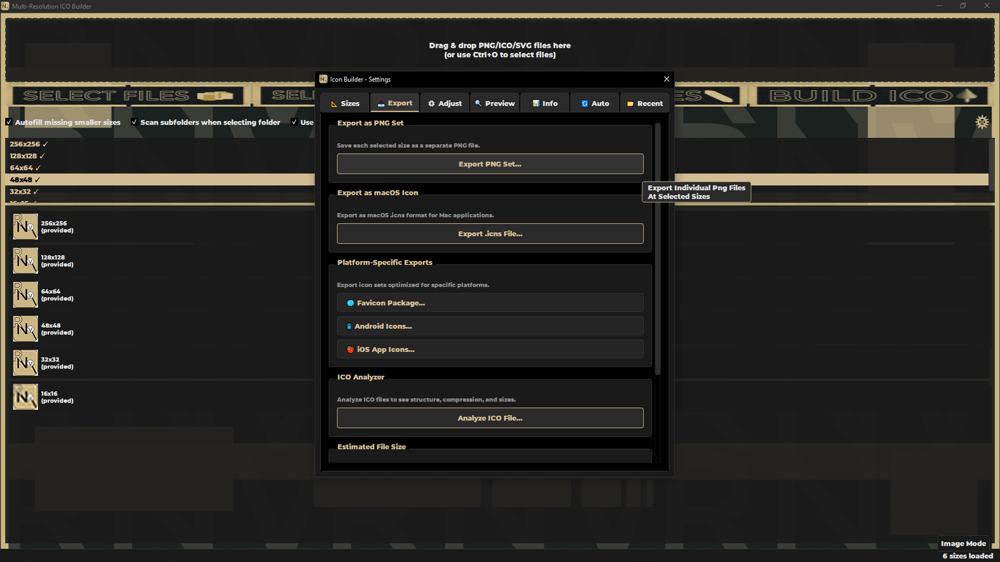
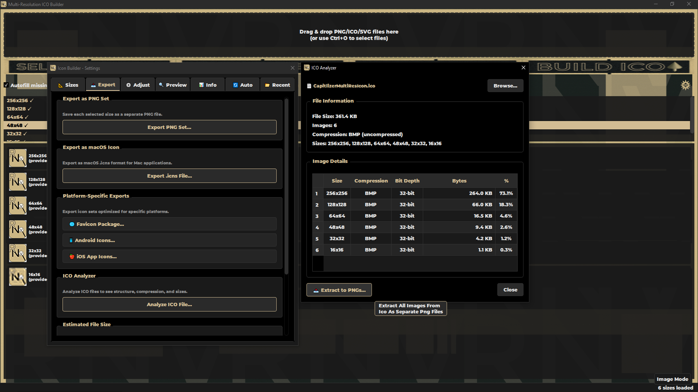
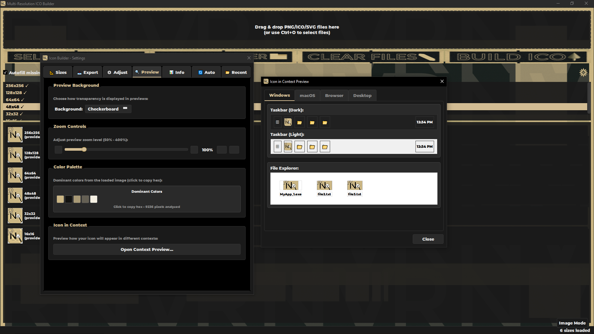

# RNV Icon Builder


[](https://github.com/RNVizion/rnv-icon-builder/actions/workflows/tests-linux.yml)
[](https://github.com/RNVizion/rnv-icon-builder/actions/workflows/tests-windows.yml)

A professional-grade desktop application for creating multi-resolution ICO files from PNG, ICO, and SVG sources. Built with PyQt6 and Pillow, featuring a polished three-theme UI, cross-platform icon exports, batch processing, and a full command-line interface.

> Part of the [RNVizion toolkit](https://github.com/RNVizion) — a suite of professional desktop tools for developers and designers.

## Screenshots








## Features

### Icon Creation
- **Multi-resolution ICO** — Build ICO files with standard sizes (256, 128, 64, 48, 32, 16px)
- **PNG compression** — Smaller files using PNG encoding for the 256 and 128 px sizes (Vista+)
- **Autofill** — Automatically generate missing smaller sizes from the largest source
- **Size detection** — A square PNG goes into the slot its pixel dimensions match, if that is a standard size; an ICO adds every standard size it holds, and an SVG is rendered at all six

### Image Adjustments
- **Transform** — Rotate 90° either way or 180°, flip horizontal/vertical
- **Crop & Resize** — Auto-crop, add padding, center resize
- **Fill & Borders** — Fill transparent areas with a color; colored borders with configurable width
- **Color** — Brightness, contrast, saturation sliders (-100 to +100), grayscale
- **Undo/Redo** — One shared 20-step history; each adjustment applies to every loaded size

### Export Formats
- **Windows ICO** — Multi-resolution with optional PNG compression
- **macOS ICNS** — Apple icon format with Retina support
- **PNG Set** — Individual PNG files for each size, named by the output filename template (Settings > Export): `{name}` is the source file's name, `{size}` the size, `{date}` and `{time}` the moment of the export. The default, `icon_{size}`, writes `icon_256.png` and so on; a template without `{size}` gets `_{size}` added, and characters a file name cannot hold become `_`
- **Favicon Package** — Complete web set with ICO, PNGs, and manifest
- **Android Icons** — `res/mipmap-*` folders (mdpi through xxxhdpi)
- **iOS App Icons** — An `AppIcon.appiconset/` folder with Contents.json

### Workflow Automation
- **Batch processing** — Queue multiple files for bulk conversion
- **Folder watching** — Monitor a folder and auto-process new images
- **Size presets** — Save and load custom size configurations, beside six built-in ones
- **Project files** — Save the loaded images and build options as `.rnvicon` files
- **Session recovery** — The session is saved every 5 minutes; after an unexpected close, the next start offers to recover it: the loaded files are loaded again from where they were, and the window's size and position and the autofill and PNG compression options come back. A file moved or deleted since is skipped. A normal close leaves nothing to recover
- **Restore last session** — With *Restore last session on startup* on (Settings > Auto; it starts off), closing the app keeps the loaded images and the autofill and PNG compression options, and the next start loads them without asking. After an unexpected close, the offer to recover comes instead, and only it
- **Project auto-save** — With *Auto-save project periodically* on (the default), an open `.rnvicon` project that has changed is saved to its own file every 5 minutes, and the status bar says so. A project never saved has no file, so it waits until you save it

### Preview & Analysis
- **Live preview** — All sizes with configurable zoom (50%–400%) and backgrounds
- **Context preview** — See icons in OS mockups (taskbar, folder, browser, dock)
- **ICO analyzer** — Examine existing ICO file structure, extract to PNGs
- **Metadata panel** — Beside the thumbnails: the file name, folder, file size and format of the size you click in the thumbnails or the size list, with its dimensions, color mode, bit depth and transparency. It shows the largest loaded size until you click another; an autofilled size is an in-memory image
- **Color palette** — Extract and display dominant colors from loaded images
- **Size estimate and build statistics** — The estimated ICO size before a build; the last build's compression and a history of ICO builds after

### Themes
- **Dark mode** — Default dark UI
- **Light mode** — Full light theme
- **Image mode** — Background image with translucent panels
- Cycle with `Ctrl+T` or the theme button (Dark → Light → Image)

### Settings

The gear button or `Ctrl+,` opens Settings. Its tabs:

- **Sizes** — which sizes go into the output, with quick buttons for All Sizes, Favicon, Windows, macOS and Clear All
- **Export** — PNG set, `.icns`, favicon, Android and iOS exports, the ICO analyzer, the estimated file size, and the output filename template for the PNG set, with a preview
- **Adjust** — the image adjustments above, with Undo and Redo
- **Preview** — preview background (checkerboard, white, black or a custom color), zoom, the color palette, and Icon in Context
- **Info** — the last build's statistics, the export history and overall export statistics
- **Auto** — the batch queue, watch folder, presets (the built-ins include *Large Only* and *Small Only*), project files, and the session settings: *Restore last session on startup* and *Auto-save project periodically*, kept from one start to the next
- **Recent** — recent files and folders; double-click one to open it again

The main window has three options of its own: *Autofill missing smaller sizes*, *Scan subfolders when selecting folder*, and *Use PNG compression*.

## Installation

### Requirements
- Python 3.13
- PyQt6
- Pillow

The version ranges are in `requirements.txt`.

### Setup

Clone the repository and install dependencies:

```bash
git clone https://github.com/RNVizion/rnv-icon-builder.git
cd rnv-icon-builder
pip install -r requirements.txt
```

### Run

```bash
python RNV_Icon_Builder.py
```

### Install as commands

Installing from the checkout adds two commands:

```bash
pip install .                 # a regular install: a copy, with resources/ in it
pip install -e .              # or an editable one, for working on the code
rnv-icon-builder              # the app, the same as python RNV_Icon_Builder.py
rnv-icon-cli --help           # the CLI, the same as python cli.py
```

A regular install copies the app and its `resources/` (font, icons, button images and
the Image-mode background) into the environment, so the checkout can go afterwards. An
editable install runs the code in the checkout and reads `resources/` from there; keep
the checkout where it is.

### Building a Standalone Executable

The repository includes platform-specific build scripts that clean caches, remove stale outputs, run PyInstaller, and verify the result.

**Windows:**
```bat
pip install pyinstaller
build_windows.bat
```

**Linux:**
```bash
pip install pyinstaller
chmod +x build_linux.sh   # First time only
./build_linux.sh
```

**Manual (any platform):**
```bash
pyinstaller --clean --noconfirm RNV_Icon_Builder.spec
```

The built executable appears in `dist/`. The included `.spec` file bundles all resources (fonts, button images, background images, and the app icon) into the binary.

## Setting up for development

Two scripts at the repository root set up a checkout. Both install the same two files:
`requirements.txt`, which is what the app needs to run, and `tests/requirements-dev.txt`,
which adds the test tools and rnv-brand at the commit this repository pins.

```powershell
# Windows (PowerShell 7)
.\in.ps1                      # makes .venv with Python 3.13 if there is none, then installs
.\.venv\Scripts\Activate.ps1
```

```bash
# Linux or Codespaces
./in.sh                       # also installs the Qt system libraries with apt-get
```

rnv-brand is installed from GitHub at a pinned commit, so the second file needs `git` and
network access. Run the script again after any change that moves the pin; the
register-pin test fails while the installed brand is not the pinned one.

## Command-Line Interface

The CLI provides full access to icon building without the GUI:

```bash
# Basic ICO creation
python cli.py input.png -o output.ico

# Custom sizes
python cli.py input.png -o output.ico --sizes 256,48,32,16

# Use a preset
python cli.py input.png -o output.ico --preset favicon

# Batch process a folder
python cli.py folder/ -o icons/ --batch

# Batch process a folder and its subfolders
python cli.py folder/ -o icons/ --batch -r

# Platform exports
python cli.py input.png --favicon-package -o web/
python cli.py input.png --android -o android/
python cli.py input.png --ios -o ios/

# Analyze an existing ICO file
python cli.py app.ico --analyze

# List available presets
python cli.py --list-presets
```

A build needs the input and `-o`; `--analyze` needs only the input, and `--list-presets` needs neither. Preset names ignore case, so `favicon` finds *Favicon*; an unknown name is reported and the build uses all six sizes. `--preset` sets the sizes only; autofill and PNG compression follow the options below.

Other options: `--no-autofill` and `--no-png-compression` turn those off (both are on by default), `-q` prints errors only, and `--version` prints the version. `python cli.py --help` lists them all.

The platform exports write:

- `--favicon-package` — `favicon.ico`, `favicon-16x16.png`, `favicon-32x32.png`, `favicon-48x48.png`, `site.webmanifest` and `favicon-html.txt` (the `<link>` tags to paste)
- `--android` — `mipmap-<density>/ic_launcher.png` and `ic_launcher_round.png` for mdpi through xxxhdpi
- `--ios` — `AppIcon.appiconset/` with its PNGs and `Contents.json`

## Keyboard Shortcuts

| Shortcut | Action |
|---|---|
| `Ctrl+O` | Open files |
| `Ctrl+Shift+O` | Open folder |
| `Ctrl+N` | Clear all files |
| `Ctrl+B` | Build ICO |
| `Ctrl+T` | Cycle theme |
| `F5` | Refresh preview |
| `Escape` | Clear selection |
| `Ctrl+S` | Save project |
| `Ctrl+Shift+S` | Save project as |
| `Ctrl+Shift+N` | New project |
| `Ctrl+,` | Settings |
| `F11` | Toggle tooltips |
| `Ctrl+/` | About |

### Mouse and drag

| Gesture | Action |
|---|---|
| Hover a thumbnail | Show it enlarged |
| Double-click a thumbnail | Open the full-size preview |
| Click a thumbnail, or a row of the size list | Show that size's details in the metadata panel |
| Right-click a thumbnail | Preview Full Size, Compare with Original (for an autofilled size), Replace this size, Remove this size |
| Drop PNG, ICO or SVG files on the window | Load them |
| Drop a folder on the window | Load its images, as Select Folder does: with its subfolders when *Scan subfolders when selecting folder* is checked |

## Project Structure

```
RNV_Icon_Builder/
├── RNV_Icon_Builder.py        # Main application entry point
├── cli.py                     # Command-line interface
├── __init__.py                # Lazy-loader for package/module dual access
├── py.typed                   # PEP 561 type-hint marker
├── RNV_Icon_Builder.spec      # PyInstaller build spec
├── RNVIconBuilder.pyproj      # Visual Studio project file
├── pyproject.toml             # Package metadata & entry points
├── requirements.txt           # Runtime dependencies
├── in.sh                      # Linux/Codespaces setup (pip + Qt system libraries)
├── in.ps1                     # Windows setup (.venv + pip)
├── brand_map.json             # Where each color comes from: rnv-brand or the app
├── COLORS.md                  # This app's color chart, written by the sync
├── ACCENT_IMAGES.md           # Every image with the gold drawn in, written by tools/accent_images.py
├── README.md                  # This file
├── CHANGELOG.md               # What changed
├── LICENSE                    # MIT license
├── .gitignore
├── clean_python_cache.bat     # Windows cache cleanup
├── clean_python_cache.sh      # Unix cache cleanup
├── build_windows.bat          # Windows build (clean + PyInstaller + verify)
├── build_linux.sh             # Linux build (clean + PyInstaller + verify)
│
├── .github/
│   └── workflows/
│       ├── brand-sync.yml     # Daily: colors from rnv-brand; a pull request only if one moved
│       ├── tests-linux.yml    # CI: Ubuntu, Python 3.13, xvfb
│       └── tests-windows.yml  # CI: Windows, Python 3.13
│
│   # Test infrastructure (root-level)
├── test_rnv_icon_builder.py   # Legacy unittest suite
├── run_tests.py               # Dual-suite runner (unittest + pytest + coverage)
├── pytest.ini                 # pytest configuration
├── setup.cfg                  # mutmut mutation-testing config
├── .coveragerc                # coverage.py config (branch mode, parallel)
├── coveragerc                 # The same settings as .coveragerc
├── coverage_report.txt        # The last full coverage report, written by run_tests.py
├── sitecustomize.py           # Subprocess-coverage bootstrap shim
├── TEST_SYSTEM.md             # Test architecture reference
│
├── core/
│   ├── __init__.py
│   ├── py.typed               # PEP 561 type-hint marker
│   ├── icon_builder_core.py   # ICO generation, format exports
│   ├── image_processor.py     # Image loading, validation, undo/redo
│   ├── batch_processor.py     # Batch file processing queue
│   ├── folder_watcher.py      # Auto-process watched folders
│   ├── preset_manager.py      # Size preset management
│   ├── project_manager.py     # .rnvicon project files
│   ├── recent_files.py        # Recent file/folder history
│   ├── session_manager.py     # Auto-save, crash recovery and the session settings
│   └── export_history.py      # Export log with timestamps
├── ui/
│   ├── __init__.py
│   ├── py.typed
│   ├── base_dialog.py         # Base dialog with signal/move mixins
│   ├── theme_manager.py       # Dark/Light/Image theme cycling
│   ├── settings_dialog.py     # Tabbed settings (Sizes, Export, Adjust, etc.)
│   ├── about_dialog.py        # About dialog with features and shortcuts
│   ├── preview_utils.py       # Checkerboard, zoom, color palette widgets
│   ├── context_preview.py     # OS context mockup previews
│   ├── ico_analyzer.py        # ICO file analysis dialog
│   ├── metadata_panel.py      # File details beside the thumbnails
│   ├── image_adjustments.py   # Transform and color adjustment functions
│   └── debug_button.py        # DebugButton: the main window's image-state action buttons
├── utils/
│   ├── __init__.py
│   ├── py.typed
│   ├── colors.py              # Brand colors, theme palettes
│   ├── config.py              # Constants, paths, feature flags
│   ├── logger.py              # Colored console + file logging
│   ├── error_handler.py       # Centralized error handling
│   ├── dialog_helper.py       # Themed message dialog helpers
│   ├── file_utils.py          # File I/O utilities and the output filename template
│   ├── atomic_write.py        # Atomic writes for the files the app keeps
│   ├── font_loader.py         # Custom font loading with fallback
│   ├── pil_compat.py          # Reads pixels with or without Pillow's getdata()
│   ├── pixmap_cache.py        # QPixmap caching layer
│   ├── signal_manager.py      # Qt signal connection tracking
│   └── async_file_ops.py      # Non-blocking file operations
├── tools/
│   ├── sync_colors.py         # Writes the colors in utils/colors.py, and COLORS.md
│   └── accent_images.py       # Writes ACCENT_IMAGES.md
├── tests/
│   ├── requirements-dev.txt   # Test-only dependencies
│   ├── conftest.py            # Shared fixtures + Qt/font/theme bootstrapping
│   ├── snapshots.json         # Reference data for test_snapshots.py
│   ├── color_values.py        # Every color value a test needs that is not the app's, named once
│   └── test_*.py              # The pytest suite (see TEST_SYSTEM.md)
├── docs/
│   └── INTERNALS.md           # Architectural reference
└── resources/
    ├── button_images/          # Button state images (base, hover, pressed)
    ├── background_images/      # Image mode background
    ├── fonts/                  # Embedded Montserrat font
    ├── icons/                  # Application icon
    └── screenshots/            # Project screenshots for README
```

## Changing a color

The app's colors live in `utils/colors.py`, but their values are not edited there.
`brand_map.json`, at the repository root, says where each one comes from: a name in
rnv-brand (such as `APP.accent`) or a value this app owns, with the reason.
`tools/sync_colors.py` writes the value on each of those lines, and writes `COLORS.md`, the
chart of this app's colors.

- **A color this app owns:** change its value in `brand_map.json`, then run
  `python tools/sync_colors.py`.
- **A brand color:** it changes in rnv-brand first. Move the pin in
  `tests/requirements-dev.txt`, reinstall (above), then run `python tools/sync_colors.py`.
  The diff of `utils/colors.py` shows exactly what moved. The `brand-sync` workflow does
  this every day and opens a pull request only when a color this app uses has moved.
- `python tools/sync_colors.py --check` writes nothing and exits 1 if the color file or
  `COLORS.md` is out of date. `tests/test_colors_in_sync.py` runs it on every test run, so
  a value edited by hand in `utils/colors.py` fails the suite until the map says the same.

A derived color, such as a lightened or translucent step of the gold, stays code in
`utils/colors.py` and follows its base.

**The images do not follow.** Button art, backgrounds and icons have the gold drawn into
their pixels. `ACCENT_IMAGES.md` lists every image that carries it; `tools/accent_images.py`
writes that list (`--check` writes nothing) and never changes an image.
`tests/test_accent_images.py` keeps the list current.

## Files the app keeps

Session recovery data, the session settings, the last session, export history, presets
and recent files (all under `~/.rnv_icon_builder/`), and `.rnvicon` projects, auto-saved
or not, are written atomically through
`utils/atomic_write.py`: the new content goes to a temporary file beside the real one, is
flushed to disk, and replaces the original in one step. A crash or a full disk during a
save leaves the old file or the new one, never half of each. Exports you ask for, such as
an ICO file or a PNG set, are not state and keep their own writers.
`tests/test_atomic_state_writes.py` lists every writer and fails if one writes in place.

## Testing

The project ships with two complementary test suites totaling **over 1,100 tests**, measured for branch coverage across all source modules. Run both via the unified runner:

```bash
python run_tests.py            # Run unittest + pytest + coverage report
python run_tests.py --summary  # The same, but the report leaves out fully covered modules
python run_tests.py --html     # Also generate htmlcov/ report
python run_tests.py --report   # Re-render report from existing data (no re-run)
python run_tests.py --fail-under=N  # Exit non-zero if total coverage is under N%
python run_tests.py --benchmark # Run pytest-benchmark suite only
```

Coverage is measured on every full run. `python run_tests.py --report` prints the current
figure for every module; it differs a little between Windows and Linux.

### Test Suite Composition

| Suite | Location | Count | Purpose |
|---|---|---:|---|
| Legacy unittest | `test_rnv_icon_builder.py` | over 400 | Original test suite, run via `unittest` |
| pytest | `tests/` | over 600 | Modern fixtures, qtbot, hypothesis, subprocess, snapshots |

The pytest suite includes property-based tests (Hypothesis), structural snapshot tests against `tests/snapshots.json`, performance benchmarks (pytest-benchmark), subprocess-isolated CLI tests in `tests/test_cli.py` that participate in coverage via a `sitecustomize.py` bootstrap, and the guard tests listed in [TEST_SYSTEM.md](TEST_SYSTEM.md#guard-tests).

### Running Suites Individually

```bash
python -m unittest test_rnv_icon_builder       # unittest only
python -m pytest tests/                        # pytest only
python -m pytest tests/ -v                     # verbose
python -m pytest tests/ -m integration         # integration-marked tests
python -m pytest tests/ --benchmark-only       # benchmarks only
```

### Test Dependencies

Install test-only dependencies separately:

```bash
pip install -r tests/requirements-dev.txt
```

This pulls in `pytest`, `pytest-qt`, `pytest-cov`, `pytest-benchmark`, `pytest-timeout`, `hypothesis`, `coverage`, `mutmut`, and rnv-brand at the pinned commit. The setup scripts above install it for you.

### Mutation Testing

Configured in `setup.cfg` for mutmut 3. It mutates one module, `ui/image_adjustments.py`, and runs the unittest class that tests it:

```bash
python -m mutmut run              # Mutate, then run the tests against each mutant
python -m mutmut results          # List the mutants that survived
python -m mutmut show <name>      # Show one mutant's diff
python -m mutmut browse           # Browse the results interactively
```

mutmut works in a `mutants/` folder at the repository root (git ignores it). To audit another module, change `source_paths` and the tests named in `pytest_add_cli_args_test_selection`. See [TEST_SYSTEM.md](TEST_SYSTEM.md#mutation-testing-phase-9--periodic-audit).

### Coverage Reports

Coverage data lives in `.coverage` (canonical) plus parallel-mode subprocess files merged automatically at the end of each run. Each report is also written to `coverage_report.txt`. With `--html`, the HTML report renders to `htmlcov/index.html`. CI runs `python run_tests.py --html --fail-under=66` on Linux and Windows: the run fails if total coverage falls under 66%, and `htmlcov/` is uploaded as an artifact.

## Documentation

- **[docs/INTERNALS.md](docs/INTERNALS.md)** — Architectural reference covering package structure, ICO format implementation, `.rnvicon` project files, theme system, signal management, and design decisions
- **[TEST_SYSTEM.md](TEST_SYSTEM.md)** — Test architecture: runner internals, fixture system, subprocess coverage, parallel-mode merging, guard tests
- **[CHANGELOG.md](CHANGELOG.md)** — What changed, newest first

## Tech Stack

- **Python 3.13** — Modern syntax with type hints throughout
- **PyQt6** — UI framework with Fusion style for cross-platform consistency
- **Pillow** — Image processing and format conversion
- **Custom ICO encoder** — Direct binary ICO generation with PNG compression
- **pytest + Hypothesis + pytest-benchmark** — Property-based, snapshot, and benchmark testing
- **coverage.py** — Branch coverage with parallel-mode subprocess tracking
- **mutmut** — Mutation testing for assertion strength validation

## License

[MIT](LICENSE)

The bundled fonts are not under MIT. Montserrat Black (the mark), Inter (the interface) and JetBrains Mono (fixed-width text) are under the SIL Open Font License 1.1, and each family's license travels with it in `resources/fonts/`: [`OFL-Montserrat.txt`](resources/fonts/OFL-Montserrat.txt), [`OFL-Inter.txt`](resources/fonts/OFL-Inter.txt) and [`OFL-JetBrains-Mono.txt`](resources/fonts/OFL-JetBrains-Mono.txt). Inter and JetBrains Mono are made from rnv-brand's files at the pinned commit by `python tools/sync_fonts.py`, one TrueType file per weight; `tests/test_fonts_in_sync.py` fails when the copy and the pin disagree.

## Author

Built by [RNVizion](https://github.com/RNVizion)
